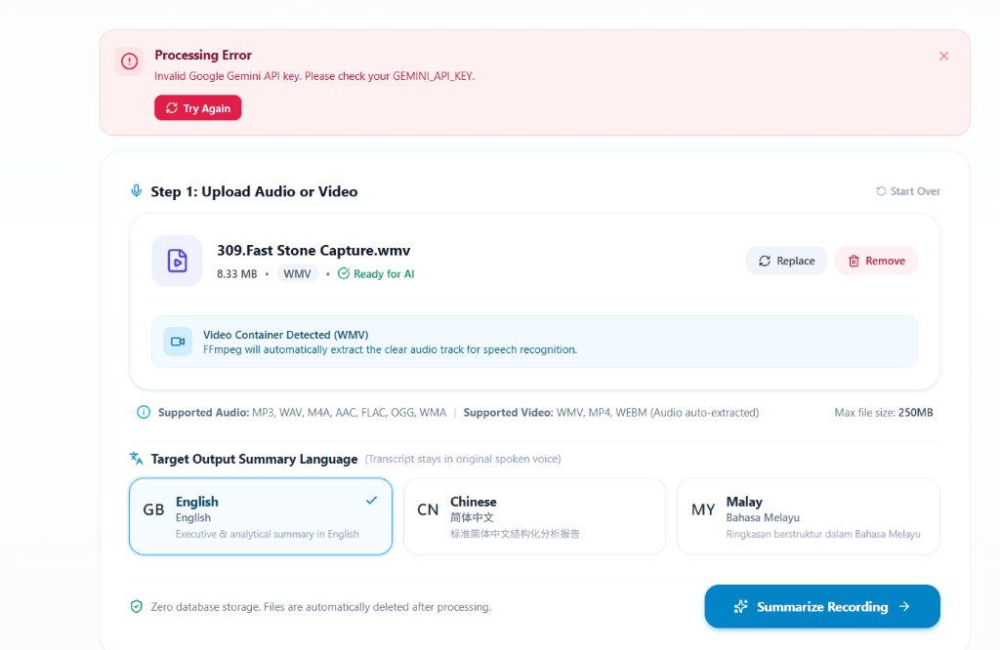
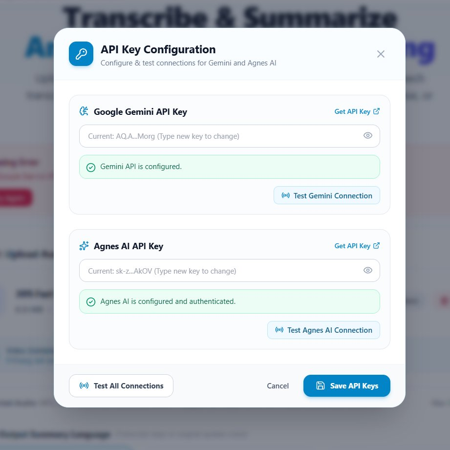

# AI Voice Summarizer

A modern, lightweight, full-stack web application that allows users to upload voice recordings or video files containing speech, automatically analyze their content using AI, transcribe the dialogue, generate a comprehensive structured summary in English, Chinese, or Malay, and export the result as an executive PDF document.

Built with **ReactJS + Vite**, **Python FastAPI**, **Tailwind CSS**, **FFmpeg**, **Google Gemini API**, **Agnes AI API**, and **ReportLab**.

---

## 📸 Screenshots

| Main Application & File Upload | API Key Settings & Live Testing |
|:---:|:---:|
|  |  |

---

## 🌟 Key Features

1. **Audio & Video Upload Interface**:
   - Modern drag-and-drop zone and file picker.
   - Live media preview with built-in audio player.
   - Real-time display of filename, file size, and format badge.
   - File replacement and quick removal.
   - Configurable 250MB maximum upload limit.
   - Supported Audio formats: `MP3`, `WAV`, `M4A`, `AAC`, `FLAC`, `OGG`, `WMA`.
   - Supported Video formats: `WMV`, `MP4`, `WebM` (audio extracted via FFmpeg).

2. **Automated FFmpeg Processing**:
   - Automatically extracts audio tracks from video files (`.wmv`, `.mp4`, `.webm`) and converts non-standard audio formats (`.wma`) into high-quality, speech-optimized MP3 streams.
   - Automatically utilizes bundled `imageio-ffmpeg` or system FFmpeg on Windows without complex manual setup.

3. **Google Gemini Audio Transcription**:
   - Sends the audio recording directly to Gemini for speech recognition.
   - Generates a full verbatim transcript.
   - Automatically detects the spoken language (English, Chinese, Malay, etc.) without altering the original speech.

4. **Agnes AI Intelligent Summarization**:
   - Produces a 5-dimension structured summary:
     - **A. Overall Summary**: High-level explanation of the entire recording.
     - **B. Key Points**: Bullet-point digest of the most critical takeaways.
     - **C. Important Details**: Notable facts, figures, and supporting arguments.
     - **D. Main Topics**: Organized discussion topics and breakdowns.
     - **E. Conclusions**: Final decisions, outcomes, and next steps.
   - Multi-language output support: **English**, **Chinese (简体中文)**, or **Malay (Bahasa Melayu)**.

5. **Professional Multilingual PDF Export**:
   - Built with Python `ReportLab`.
   - High-grade typography with automatic Windows Unicode CJK font registration (Microsoft YaHei / SimHei / SimSun).
   - Generates clean, publication-ready PDF reports with headers, page numbers, metadata boxes, and zero text overflow.
   - Instant single-click browser download.

6. **Privacy & Zero-Database Architecture**:
   - No SQL database (No MySQL, PostgreSQL, or SQLite).
   - All uploaded and extracted files are treated as temporary and immediately deleted upon completion or failure.

---

## 🛠️ Technology Stack

| Layer | Technologies |
|---|---|
| **Frontend** | React 19, Vite, Tailwind CSS, Axios, Lucide React |
| **Backend** | Python 3.11+ / 3.14, FastAPI, Uvicorn, Pydantic |
| **Audio Processing** | FFmpeg (via `imageio-ffmpeg` or system executable) |
| **Speech AI** | Google Gemini API (`gemini-1.5-flash`) |
| **Summarization AI** | Agnes AI API (`agnes-2.5-flash` via OpenAI-compatible endpoints) |
| **PDF Generation** | ReportLab with Unicode Font Registration |

---

## 📁 Project Architecture

```
AI_voice_summarizer/
│
├── frontend/                     # ReactJS + Vite Web Interface
│   ├── src/
│   │   ├── components/           # UI Components
│   │   │   ├── Navbar.jsx        # Navigation bar & API status indicator
│   │   │   ├── FileUpload.jsx    # Drag-and-drop file upload area
│   │   │   ├── AudioPreview.jsx  # In-browser audio player preview
│   │   │   ├── LanguageSelector.jsx # English / Chinese / Malay selection
│   │   │   ├── ProcessingStatus.jsx # Real-time multi-stage AI loader
│   │   │   ├── SummaryDisplay.jsx# 5-section AI summary card & copy button
│   │   │   └── ErrorAlert.jsx    # Friendly error messaging
│   │   ├── services/
│   │   │   └── api.js            # Axios client with upload progress
│   │   ├── App.jsx               # Single-page application root
│   │   ├── main.jsx              # Vite entrypoint
│   │   └── index.css             # Tailwind base & custom styles
│   ├── package.json
│   ├── tailwind.config.js
│   └── vite.config.js
│
├── backend/                      # Python FastAPI Backend
│   ├── app/
│   │   ├── ai/
│   │   │   ├── gemini_service.py # Gemini speech transcription
│   │   │   └── agnes_service.py  # Agnes AI structured summarizer
│   │   ├── config/
│   │   │   └── settings.py       # Pydantic configuration & env loader
│   │   ├── routes/
│   │   │   └── summarize.py      # /api/process & /api/download-pdf
│   │   ├── services/
│   │   │   ├── audio_processor.py# FFmpeg audio extractor & converter
│   │   │   └── pdf_service.py    # ReportLab multilingual PDF builder
│   │   ├── utils/
│   │   │   └── file_utils.py     # Safe file deletion & temp file handling
│   │   └── main.py               # FastAPI application setup & CORS
│   ├── temp/                     # Temporary processing directory (.gitignore)
│   ├── requirements.txt          # Python dependencies
│   ├── .env.example              # Configuration template
│   └── .env                      # Local secret keys
│
├── README.md
└── .gitignore
```

---

## 🚀 Quick Start Guide (Windows)

### Prerequisites

Ensure you have installed:
1. **Python 3.11+** ([python.org](https://www.python.org/downloads/)) - *Make sure to check "Add Python to PATH" during installation*.
2. **Node.js 18+** ([nodejs.org](https://nodejs.org/)) - *Includes npm*.

---

### Step 1: Clone or Navigate to the Project

Open **PowerShell** or **Command Prompt**:

```powershell
cd c:\xampp\htdocs\AI_voice_summarizer
```

---

### Step 2: Configure Environment Variables

1. In the `backend` folder, duplicate `.env.example` as `.env`:

```powershell
Copy-Item backend\.env.example backend\.env
```

2. Open `backend/.env` with your preferred editor (Notepad, VS Code, etc.) and enter your API keys:

```env
# Google Gemini API Key (Get from: https://aistudio.google.com/app/apikey)
GEMINI_API_KEY=AIzaSy...

# Agnes AI API Key (Get from: https://apihub.agnes-ai.com)
AGNES_API_KEY=sk-...

# Optional configurations:
AGNES_BASE_URL=https://apihub.agnes-ai.com/v1
AGNES_MODEL=agnes-2.5-flash
GEMINI_MODEL=gemini-1.5-flash
MAX_UPLOAD_SIZE_MB=250
```

> **Note on FFmpeg**: The backend includes `imageio-ffmpeg` by default, which provides an embedded Windows `ffmpeg.exe` binary. You do **not** need to manually download or configure FFmpeg. If you already have FFmpeg installed on your system, the backend will automatically recognize it.

---

### Step 3: Install Backend Dependencies

In the project root directory, run:

```powershell
pip install -r backend\requirements.txt
```

---

### Step 4: Install Frontend Dependencies

```powershell
cd frontend
npm install
cd ..
```

---

### Step 5: Run the Application

You will run the backend and frontend in two terminal windows:

#### Terminal 1 — Start Backend Server:

```powershell
python -m uvicorn backend.app.main:app --reload --port 8000
```
*Backend will start at: `http://127.0.0.1:8000` (API documentation available at `http://127.0.0.1:8000/docs`).*

#### Terminal 2 — Start Frontend Server:

```powershell
cd frontend
npm run dev
```
*Frontend will start at: `http://localhost:5173`.*

Open your web browser (Chrome, Microsoft Edge, or Firefox) and navigate to **`http://localhost:5173`**.

---

## 📖 User Workflow

1. **Upload Recording**:
   - Drag and drop your audio (`.mp3`, `.wav`, `.m4a`, etc.) or video (`.wmv`, `.mp4`, `.webm`) into the upload box or click **Browse Files**.
   - Check the audio preview player or video container info card.
2. **Select Output Summary Language**:
   - Choose between **English**, **Chinese (简体中文)**, or **Malay (Bahasa Melayu)**.
   - The speech transcript retains its original spoken dialogue; the summary will be translated and composed in the target language.
3. **Click "Summarize Recording"**:
   - The multi-stage AI pipeline initiates:
     - Media Upload ➔ FFmpeg Stream Extraction ➔ Gemini Speech Transcription ➔ Agnes AI 5-Point Summary.
4. **Review Summary & Copy**:
   - Inspect the sections: *Overall Summary*, *Key Points*, *Important Details*, *Main Topics*, and *Conclusions*.
   - Click **Copy Summary** to quickly copy the entire report to your clipboard.
5. **Download PDF Report**:
   - Click **Download PDF** to export a clean, multi-page PDF document formatted with typography and page numbers.

---

## 🔧 Troubleshooting & FAQ

| Problem | Cause | Solution |
|---|---|---|
| **"Google Gemini API Key is not configured"** | Missing `GEMINI_API_KEY` in `backend/.env` | Open `backend/.env` and paste a valid Gemini API key obtained from [Google AI Studio](https://aistudio.google.com/). |
| **"Agnes AI API Key is not configured"** | Missing `AGNES_API_KEY` in `backend/.env` | Open `backend/.env` and paste your Agnes API key. |
| **"Unsupported file format"** | Uploaded file extension is not in the whitelist | Ensure the file is one of: `.mp3`, `.wav`, `.m4a`, `.aac`, `.flac`, `.ogg`, `.wma`, `.wmv`, `.mp4`, `.webm`. |
| **"File exceeds maximum allowed size"** | Upload is larger than 250MB | Compress the file or increase `MAX_UPLOAD_SIZE_MB` in `backend/.env`. |
| **"FFmpeg is required..."** | FFmpeg executable missing | `imageio-ffmpeg` is installed in `requirements.txt`. If you still encounter issues, specify `FFMPEG_PATH=C:\path\to\ffmpeg.exe` in `backend/.env`. |
| **PDF Chinese characters display as squares or question marks** | Missing Unicode font | The PDF engine automatically loads `msyh.ttc` (Microsoft YaHei) or `simhei.ttf` from `C:\Windows\Fonts`. Ensure standard Windows fonts are accessible. |

---

## 📄 License

This project is created for educational and professional demonstration purposes.

